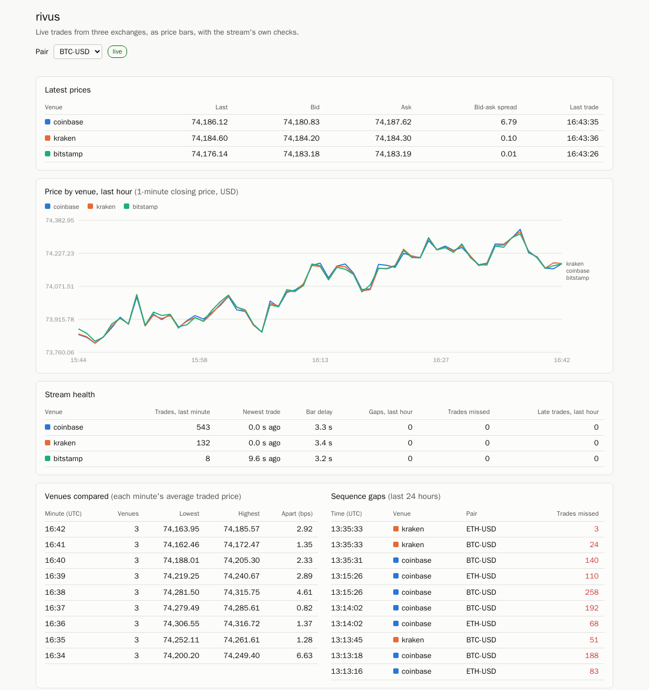
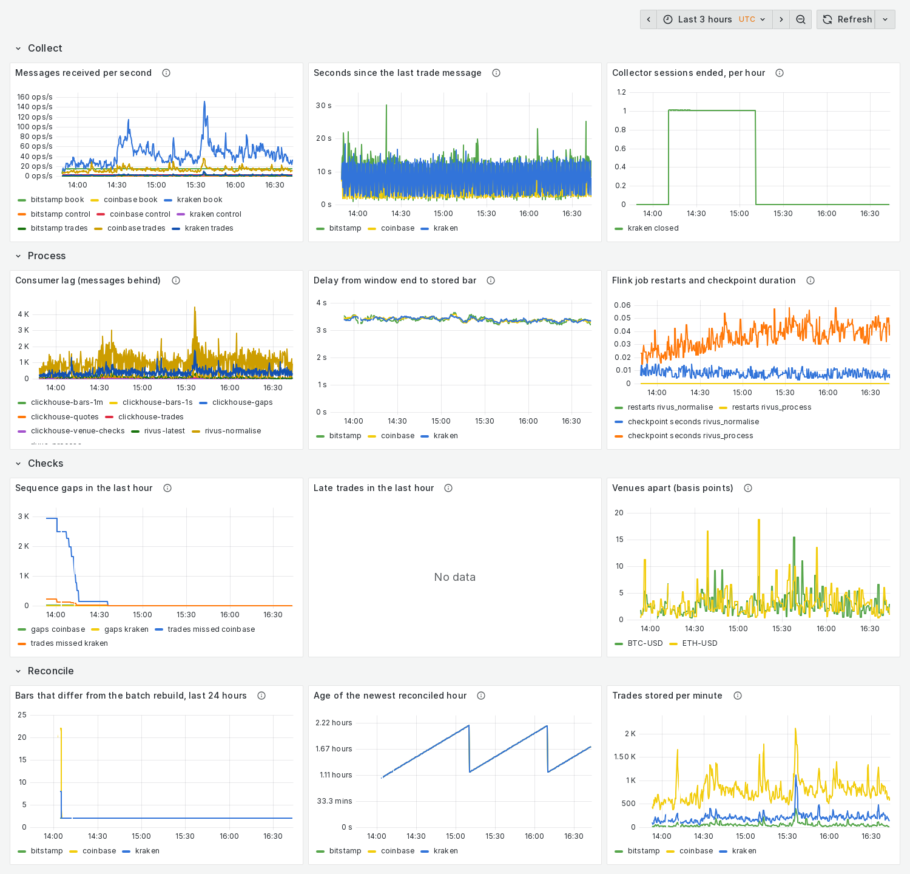
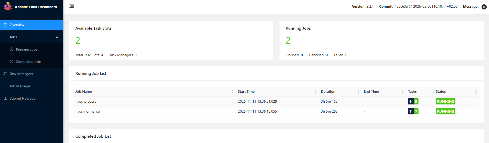
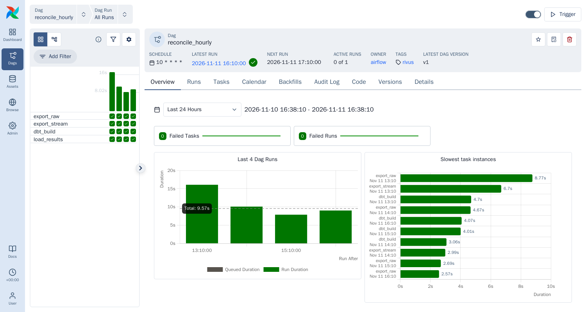

# rivus

Live trades and best bid/offer from three crypto exchanges, turned into price bars in real
time, checked for problems as they flow, and rebuilt in batch every hour to prove the stream
got it right. *rivus* is Latin for "stream".

> **Independent personal project**, built on personal time and equipment. Not affiliated with
> or endorsed by any exchange named here. It reads the exchanges' public market-data feeds;
> fetched data is never committed and no data is served to anyone; the only venue-derived
> material here is the screenshots below, which show a few moments of it. Sources and the
> status of each venue's terms: [`docs/PROVENANCE.md`](docs/PROVENANCE.md).

```
Coinbase ─┐
Kraken   ─┼─▶ collectors ─▶ Kafka ─▶ Flink SQL ─▶ ClickHouse ─▶ C# API ─▶ web page
Bitstamp ─┘   (Python)      raw      bars, gaps,   (history)     + SignalR   (live)
                            topics   late events,  Redis
                                     cross-venue   (latest price)
                                     checks
                 Airflow (hourly): export raw trades ─▶ dbt on DuckDB ─▶ rebuilt bars
                                   ─▶ compare with the stream's bars ─▶ differences table
                 Prometheus + Grafana: throughput, lag, gaps, reconciliation breaks
```

## What it shows

- **Streaming with event time.** Bars are built on the venues' own timestamps, with
  watermarks, late-trade accounting and sequence-gap detection, in Flink SQL.
- **Stores chosen for the job.** Kafka for transport and replay, ClickHouse for history, Redis
  for the latest value.
- **A stream that is checked.** Every hour a batch job (Airflow, dbt on DuckDB) rebuilds the
  bars from the raw messages with separately written parsing and classifies every difference.
- **Recovery that was tested.** Jobs resume from checkpoints; everything downstream of the raw
  topics can be rebuilt by replaying them.

Read [docs/ARCHITECTURE.md](docs/ARCHITECTURE.md) for how it fits together and
[docs/BUILD_LOG.md](docs/BUILD_LOG.md) for what was predicted, what happened and what broke.

## What it looks like

It runs on one machine and is not hosted anywhere, so here are its screens.

**The page.** Latest prices pushed over SignalR, the last hour of 1-minute bars per venue,
stream health, the cross-venue check and the sequence gaps. The hourly reconciliation is
further down the same page.



**Grafana.** One row per stage: messages per second and silence per venue; consumer lag and
the delay from the end of a bar's window to the bar being stored (about 3.5 seconds); gaps,
late trades and how far the venues are apart; bars that differ from the batch rebuild.



**Flink.** The two streaming SQL jobs, `rivus-normalise` and `rivus-process`.



**Airflow: the hourly reconciliation.** Four tasks per run: export the hour's raw trades,
export the stream's bars, rebuild and compare with dbt, load the result.



## Run it

Needs only Docker (about 6 GB of memory for the stack). Nothing is installed on the host.

```sh
docker compose up -d --build        # first start
docker compose logs -f flink-submit # watch the two Flink jobs being submitted
```

After changing code, rebuild with `BUILDX_NO_DEFAULT_ATTESTATIONS=1 docker compose up -d --build`.
Without that variable Docker gives every image a new id on every build and restarts all
containers, and a restarted collector misses trades.

Look at it:

| What | Where |
|---|---|
| The page: live prices, chart, checks | <http://localhost:18080> |
| Grafana dashboard | <http://localhost:13000> |
| Prometheus | <http://localhost:19090> |
| Flink web UI | <http://localhost:18081> |
| Airflow (the hourly reconciliation) | <http://localhost:18082> |

```sh
# row counts per table and venue
docker compose exec -T clickhouse clickhouse-client --user rivus --password rivus < scripts/counts.sql
# rebuild every bar from the stored trades and compare with what the stream produced
docker compose exec -T clickhouse clickhouse-client --user rivus --password rivus < scripts/check_bars.sql
# latest price for one venue and pair
docker compose exec redis redis-cli hgetall latest:kraken:BTC-USD
# raw messages as received
docker compose exec kafka /opt/kafka/bin/kafka-console-consumer.sh \
  --bootstrap-server localhost:9092 --topic raw.kraken.trades --from-beginning --max-messages 3
```

Tests (all run in Docker):

```sh
docker compose --profile test build
docker compose --profile test run --rm collectors-test   # Python lint and tests
docker compose --profile test run --rm latest-test
docker compose --profile test run --rm api-test          # dotnet build and tests
docker compose --profile test run --rm batch-test        # dbt run for real against fixtures
docker compose --profile test run --rm flink-sql-test    # the SQL jobs against fixtures
```

Reconcile one hour by hand (Airflow does this by itself at ten past each hour):

```sh
docker compose exec airflow bash -c \
  "cd /opt/rivus && /home/airflow/batch-venv/bin/python -m rivus_batch all --hour 2026-11-11T13:00:00"
```

Rebuild everything downstream from the raw topics (collection keeps running):

```sh
bash scripts/replay.sh
```

## Where things are

| Path | What |
|---|---|
| `compose.yaml` | every service |
| `collectors/` | the Python collector; `venues/*.yaml` is one file per exchange |
| `infra/kafka/` | topic creation |
| `flink/sql/` | `tables.sql` (every topic as a table), `normalise.sql`, `process.sql` |
| `flink/submit.sh` | keeps the jobs running and resumes them from checkpoints |
| `clickhouse/init/` | tables fed from Kafka |
| `latest/` | the Redis latest-price writer |
| `api/` | the C# service: REST API, SignalR hub, and the page in `wwwroot/` |
| `batch/` | the hourly reconciliation: `dags/`, the steps in `rivus_batch/`, the dbt project in `dbt/` |
| `monitoring/` | Prometheus config and the Grafana dashboard (generated by `make_dashboard.py`) |
| `scripts/` | checks and the replay script |
| `docs/` | [architecture](docs/ARCHITECTURE.md), [decisions](docs/DECISIONS.md), [build log](docs/BUILD_LOG.md), [glossary](docs/GLOSSARY.md), [provenance](docs/PROVENANCE.md) |
| `.github/workflows/ci.yml` | runs every test suite on each push |
